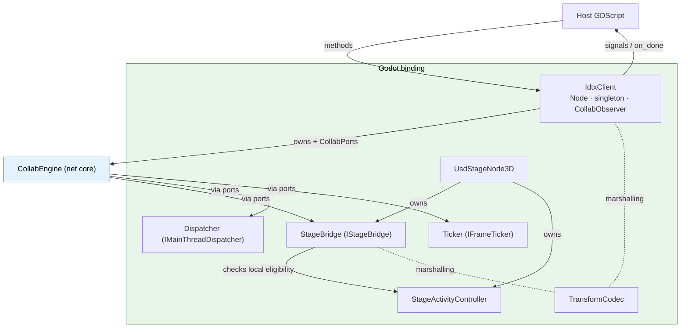

# Godot Binding

The Godot binding is the engine-specific C++ (GDExtension) that connects the
[engine-agnostic net core](net-core.md) to Godot, in the editor and at runtime. It
is where Godot (`godot::`) and OpenUSD (`pxr::`) types meet. It implements the
engine-specific ports, converts between Godot and core types, exposes a
GDScript-facing API, and is the composition root that wires everything together.

It lives in:

| Path | Contents |
|---|---|
| `source/collab/` | `IdtxClient`, `Dispatcher`, `Ticker` |
| `source/stage_ops/` | `StageBridge`, `StageEditController`, `StageActivityController`, `StageReloadController`, `PayloadPlacement`, `TransformCodec` (see [stage-authoring.md](stage-authoring.md); `StageReloadController` rebuilds a session's stage nodes on layer reload and reconnect, see [net-core.md](net-core.md)) |
| `source/nodes/` | USD node types (`UsdStageNode3D` + converted prim nodes) |
| `source/register_types.cpp` | Module boot: class registration, singleton, composition root |

---

## IdtxClient

A Godot `Node` registered as the global engine singleton `"IdtxClient"`. It
implements `CollabObserver`, owns the `CollabEngine`, and is the composition root.
It contains no networking, protocol, or USD logic — all of that lives behind the
engine and its ports.

**Lifecycle.** The singleton is created and registered from C++ at module init
(before any script runs) and started via `initialize(transport_factory)`. It lives
**outside the scene tree**, so its per-frame `poll()` is driven by wiring to
Godot's per-frame signal through a small deferred, self-retrying connect that waits
until the SceneTree exists. `shutdown()` tears everything down and detaches the
singleton.

**GDScript-facing API.** Reachable as `Engine.get_singleton("IdtxClient")`:

- **Config / auth:** `set_base_url`, `get_base_url`, `is_authenticated`,
  `get_access_token`, `clear_credentials`.
- **REST (async):** `login`, `health`, `fetch_thumbnail`, `list_files`,
  `list_sessions`, `get_session`,
  `commit_session`, `check_download_exists`, `check_thumbnail_exists`. Each
  optionally takes an `on_done` Callable that receives a result Dictionary —
  `{ "ok": true, "result": <payload> }` on success, or
  `{ "ok": false, "http_code", "error_code", "message" }` on failure. `result` is
  an Array of session dicts for `list_sessions`, a session dict for `get_session`,
  `{ session_id, committed }` for `commit_session`, and `{ exists: bool }` for the
  two `check_*_exists` probes (a 404 resolves as `exists: false`, not an error).
- **Session flow (multi-session):** `open_new_session(usd_file, mode, auto_commit, on_done)` (create) and
  `open_existing_session(session_id, on_done)` (join) each run the core's
  obtain → `enter_session` → open-socket sequence and then report the per-request
  `on_done` completion (result carries `session_id`, `stage_url`, `ws_url`);
  `end_session(session_id)` tears down that one session. The client can hold several
  concurrent sessions, each keyed by
  its id with its own socket + stage. `open_existing_session` refuses a session already held,
  failing fast with `error_code: "already_joined"` (no round-trip) — the server currently can't detect a
  same-client re-join, so this guard is client-side. The Godot client is
  leave-only: it never creates a bare session or destroys one server-side
  (the backend auto-tears-down a session once its last client leaves), so
  `open_new_session` / `end_session` are the only session-lifecycle entry
  points exposed here. This is distinct from the raw REST calls
  above (which only issues the request).
- **URL helpers:** `download_url`, `ws_base_url`.
- **Session state:** `is_socket_open(session_id)`. (Socket lifecycle is owned by the engine's
  session flow; there are no separate open/close-socket calls.)
- **Session sync binding (per session):** `bind_session(session_id, stage_node, remote)`,
  `unbind_session(session_id)`. (Binding records which stage node a session drives and borrows
  that node's bridge; local transform authoring is driven node-side — see
  [stage-authoring.md](stage-authoring.md).)

**Signals.** `IdtxClient` implements `CollabObserver` and converts each socket-lifecycle
callback into a Godot signal (and, for a request, into that request's `on_done` dictionary).
Session **acquisition** (create/join) is reported only via the per-request `on_done`
completion (result includes `session_id` + resolved `stage_url` + `ws_url`)
Every socket-lifecycle signal carries the `session_id` it belongs to,
so a host tracking multiple concurrent sessions can route each event to the right session/scene:

| Signal | Fired when |
|---|---|
| `session_closed(session_id)` | `end_session(session_id)` completed |
| `socket_opened(session_id)` | session WebSocket connected |
| `handshake_received(session_id, usd_path, usd_uri)` | server handshake for the session |
| `transform_broadcast_received(session_id, prim_path, xform, from_client_id)` | a transform broadcast arrived; structural broadcasts do not emit this signal |
| `snapshot_complete(session_id)` | the server snapshot boundary arrived; stage loading/conversion may still be pending |
| `ack_received(session_id, request_id, request_kind, ok, error)` | server result with the request ID and its locally tracked kind |
| `prim_created(session_id, prim_path, request_id)` | a prim was created in the live session; `request_id` is the ID `request_create_prim` returned for this client's create, 0 for another client's. Emitted after the prim's node was added under the stage node. Creates replayed by a snapshot (join, reconnect) are not reported |
| `socket_error(session_id, code, message)` | protocol-level socket error |
| `socket_disconnected(session_id, reason, code, text)` | socket closed/dropped |

So GDScript never sees a core type: it calls methods, awaits `on_done`
dictionaries, and reacts to signals.

### Structural requests

The same native methods are available to runtime scripts and editor tools:

| Method | Meaning |
|---|---|
| `request_create_prim(session_id, parent_path, spec)` | Ask the server to create a child beneath the exact USD parent path. |
| `request_delete_prim(session_id, prim_path)` | Request `active=false` for that prim. |
| `request_restore_prim(session_id, prim_path)` | Request `active=true` for that prim. |

For creation, `spec` contains either `type` (`Xform`, `Cube`, `Sphere`, `Cone`,
`Cylinder`, `Capsule`, or `Plane`) or `reference_path` with optional `payload`
(`false` for a reference, `true` for a payload). An optional `transform: Transform3D`
supplies initial placement. The server assigns the child name and default
dimensions; size/radius/height fields are not exposed by this GDScript method.

These methods return an integer request ID: `0` means not submitted; a positive
ID means submitted to the transport, not confirmed delivery or acceptance. They
do not modify the scene optimistically.
The engine sends only when the session is remote, its snapshot is complete, and
its socket is open. Unlike outgoing transforms, these request methods do not
check the post-attach arming gate. Hosts should also wait for successful loading
and settling before enabling actions against converted nodes.

Server broadcasts apply creation/activity changes through the bound stage bridge.
Caller-side request ID tracking is optional: callers can ignore the returned ID
and use `ack_received` for general status via `request_kind`, `ok` and `error`.
Signal handlers still accept all five arguments; name an unused ID `_request_id`.
For per-action results, match the signal's ID to the returned ID within the same
session membership.
Its `request_kind` uses the `IdtxClient` constants `REQUEST_KIND_UNKNOWN`,
`REQUEST_KIND_TRANSFORM`, `REQUEST_KIND_CREATE_PRIM`, `REQUEST_KIND_DELETE_PRIM`,
`REQUEST_KIND_RESTORE_PRIM` and `REQUEST_KIND_SNAPSHOT` (values 0–5). References and
payloads use the create kind; the snapshot kind is the request the client sends
itself after rebuilding a stage (layer reload or reconnect). A kind can be unknown when native tracking metadata is unavailable; a valid
ID can still match a caller's own pending request. An Ack does not confirm
scene conversion completion.
See [structural-edits.md](structural-edits.md)
for path rules, current server policies, examples, and the request/broadcast flow.

---

## Engine-specific ports (the adapters this binding implements)

These are the ports the net core requires that can only be implemented in terms of
Godot (and, for the stage, OpenUSD). Everything else (transports, token, clock) is
reused from `shared/` — see [net-core.md](net-core.md).

| Adapter | Port | Responsibility |
|---|---|---|
| `StageBridge` | `IStageBridge` | Applies edits to USD, reads transforms and reports local changes without echoing external edits. Owned by `UsdStageNode3D`; borrowed by a session. |
| `Dispatcher` | `IMainThreadDispatcher` | Runs callbacks on Godot's main thread. |
| `Ticker` | `IFrameTicker` | Drives the collaboration engine once per frame. |

For authoring and supporting helpers, see [stage-authoring.md](stage-authoring.md).
Transform conversion and synchronization are detailed in
[transform-sync-flow.md](transform-sync-flow.md).

---

## USD nodes (`source/nodes/`)

The imported stage is represented as a tree of Godot `Node3D`s:

- **`UsdStageNode3D`** — loads and converts the USD stage into child nodes and
  emits `stage_loading_finished`. The host attaches transform sync to this node
  after a successful load.
- **Converted prim nodes** — `UsdXFormNode3D`, `UsdMeshInstanceNode3D`,
  `UsdMultiMeshInstanceNode3D`, `UsdSkeletonNode3D`, `UsdStaticBodyNode3D`. They
  share the `IUsdNode3D` mixin (which carries the prim path and a back-pointer to
  the stage node) and are the **outbound origin**: a gizmo move fires
  `NOTIFICATION_TRANSFORM_CHANGED`, which the owning `UsdStageNode3D` routes through
  `author_node_transform` → `StageEditController` → its bridge (see
  [stage-authoring.md](stage-authoring.md)).

> `UsdRestDatasourceNode3D` and `UsdMockDatasourceFloatNode3D` also live here but
> belong to the separate compute/exec-bridge feature, not the collaboration client.

---

## Module boot & composition root (`register_types.cpp`)

At module init (`MODULE_INITIALIZATION_LEVEL_SCENE`) the extension:

1. Registers the node classes and `IdtxClient` with `ClassDB`.
2. Creates the `IdtxClient`, registers it as the `"IdtxClient"` engine singleton,
   and calls `initialize(std::make_unique<IxTransportFactory>())` — the one place
   that picks the concrete transport library.
3. Configures the **USD HTTP asset resolver** with a `JwtHttpFetcher` (built via
   `make_jwt_fetcher(factory)`) so authenticated `/download/<path>` assets can be
   fetched; the fetcher reads the current token from the shared token provider at
   fetch time.

Teardown (`uninitialize`) shuts the client down and frees it.

---

## How it plugs into the core

`IdtxClient` assembles `CollabPorts` from two sources: Godot's `Dispatcher` and
`Ticker`, and the shared `CollabComposition` helpers' HTTP transport, WebSocket
factory, token and clock. It hands those ports to `CollabEngine::initialize`.
The engine creates one WebSocket transport per session; the host separately
attaches that session's borrowed `StageBridge` after loading. The client receives
results through the
`CollabObserver` interface and converts it to Godot signals / `on_done`
dictionaries. The full "reuse vs. implement" split is in
[net-core.md](net-core.md#portability--what-a-new-host-engine-reuses-vs-implements).

