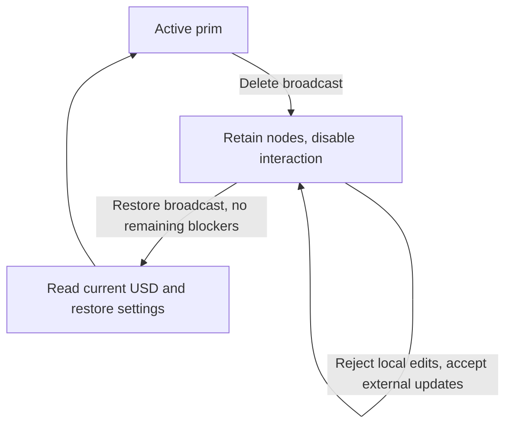

# Stage Authoring — node-owned bridge

How a Godot transform edit becomes a USD edit on the live stage, for **both**
local (session-less) editing and collaboration, through a single path owned by the
stage node. The same bridge applies server-created prims and active-state changes.

This is the authoring half of the client. The collaboration *wire journey* (how an
authored edit reaches peers and how a peer edit is applied) is in
[transform-sync-flow.md](transform-sync-flow.md); the engine-agnostic core and its
ports are in [net-core.md](net-core.md); the Godot adapters in
[godot-binding.md](godot-binding.md). Create/Delete/Restore requests and server
policy are described in [structural-edits.md](structural-edits.md).

---

## The one-bridge-per-stage model

Each `UsdStageNode3D` **owns** its authoring bridge:

- `UsdStageNode3D::get_or_create_bridge()` lazily creates one `StageBridge` over
  the node's live stage and returns it on every later call. One bridge → one USD
  `TfNotice` listener → one guarded authoring path per stage.
- The bridge's lifetime equals the stage's: it is reset **before**
  `stage_handle_.reset()` at every teardown site, so `~StageBridge` can revoke its
  TfNotice on a still-live stage.
- Collaboration does **not** create its own bridge. `IdtxClient::attach_bridge`
  *borrows* the node's bridge (`get_or_create_bridge()`) and hands it to
  `CollabEngine::attach_stage`; detach only unhooks the engine's sink. One stage
  therefore has exactly one bridge and one TfNotice listener, whether or not a
  session is attached.

The bridge, edit and activity controllers, transform codec and payload placement
helper live in `source/stage_ops/`, an edit-agnostic home because authoring serves
local editing as well as collaboration.

---

## The unified gate — local OR session, one path

A converted prim node whose transform changes (gizmo drag or Inspector edit) calls
`UsdStageNode3D::author_node_transform(child)`, which uses a `StageEditController`
borrowing the owning stage and bridge to call
`author_from_node(child, authoring_enabled, author_root)`:

```
NOTIFICATION_TRANSFORM_CHANGED
        ▼
UsdStageNode3D::author_node_transform(child)
        ▼
StageEditController(owner, bridge).author_from_node(child, local_authoring_, author_placement_root_)
        │   require an active, available prim owned by this stage
        │   skip if  !bridge->has_on_changed()  AND  !authoring_enabled
        │   skip if  node has no prim path
        │   skip if  bridge->is_stage_root(prim_path)  AND  !author_root
        ▼
bridge->author_edit(transform_to_prim_edit(prim_path, child->get_transform()), EditOrigin::Local)
```

- **Inclusive gate.** The edit is authored when **either** a session drives the
  stage (a change-report sink is installed → `has_on_changed()`), **or** the node
  opted into local authoring (`local_authoring`, an Inspector bool, off by
  default). Local simply means *no sink is installed, so nothing broadcasts* — the
  write still lands in the stage.
- **Mutual exclusion** is preserved: a session installs the sink, so the local
  branch stands down (it only acts when there is no sink). One move → one author.
- The controller borrows the stage and bridge. It rejects edits to foreign or
  inactive prims; programmatic presentation updates do not start another edit.

---

## What the bridge authors

`StageBridge::author_edit(edit, origin)` dispatches `Transform`, `CreatePrim` and
`SetActive` edits. For transforms it calls `author_transform`, then
`author_to_usd(prim_path, Transform3D)`:

- **Edit target.** `EditTarget{SessionLayer, RootLayer, OverrideLayer}` selects the
  composed layer written. Default `SessionLayer` is the in-memory, non-destructive
  override slot (the opened file is untouched); `RootLayer` edits the opened file
  directly; `OverrideLayer` behaves as `SessionLayer`. Local and collab both use
  the session-layer slot.
- **Local transform, not world.** The node's *local* transform is authored. A
  parent move changes a child's world transform but not its local, so children are
  not re-authored on a parent move.
- **Unchanged-matrix guard.** If the stored matrix already equals the new one
  (within `1e-9`), the write is skipped. Godot fires
  `NOTIFICATION_TRANSFORM_CHANGED` on descendants when an ancestor moves, and
  conversion-time writes re-set the imported value; re-authoring the same value is
  a redundant USD write that would still trip a `TfNotice` (and, in a session, a
  broadcast), so it bails.
- **Presentation strip.** Built-in Cone/Cylinder/Capsule visuals carry a
  load-time spine-axis rotation; the author path strips it so USD stores the raw
  orientation. Plane orientation is part of its mesh resource. Payload carriers
  use their separate raw/display mapping. See
  [matrix and presentation conventions](transform-sync-flow.md#matrix-and-presentation-conventions).

---

## Placement root — display-only, not authored (transform policy)

The stage's **placement root** is its `defaultPrim` (e.g. `/World`). It carries
display-only placement (metres-per-unit scale + up-axis rotation), so moving it is
a Godot-only gesture and is **not** authored by default:
`StageEditController` skips a prim for which `bridge->is_stage_root(prim_path)` is
true, unless the node sets `author_placement_root` (an Inspector bool, default
off). `is_stage_root` resolves from `defaultPrim`, so it survives the `.scn` cache
reload.

This skip is a **transform-authoring policy**, scoped to transform edits - it is
not a universal "the root is untouchable" rule.
Core protects its `defaultPrim` from deletion as a separate structural policy.

---

## Nested stages & sub-stage routing

A referenced/payloaded sub-scene loads as its **own** `UsdStageNode3D`, rooted at
`/`, with its **own** bridge, index, and `local_authoring` flag. Consequences:

- A prim inside a sub-scene is authored against the **nearest** ancestor stage
  node, so its edit lands in that sub-stage's layer (not the base stage's). Each
  sub-stage node gates independently (its own `local_authoring` / session sink).
- A move of a *holder* node (a prim that carries a reference/payload arc, e.g.
  `/World/Environment`) is authored on the **parent** stage: it repositions the
  arc's placement in the *referencing* layer. It does **not** modify the referenced
  sub-USD's own root. (A node that *is itself* a sub-stage authors against its
  containing stage via an ancestor walk.)

### Reference/payload holders are typeless — author and read them anyway

Arc holders are idiomatically authored as a **typeless** `def "Name"
(references/payload = …)` whose local transform lives on that prim. A typeless prim
is not an xformable *by schema type*, yet carries a valid `xformOpOrder`. Both the
write and read paths accept the same prims so a holder's authored placement can
also be read back; the outbound path reports a change by *reading* the prim. The
`UsdGeomXformable` API
(`AddTransformOp`/`GetOrderedXformOps`/`GetLocalTransformation`) works on a typeless
prim regardless of the typed-schema check.

### Payload placement and its support boundary

`PayloadPlacement` separates the carrier's editable placement from the converted
asset root so placement is applied once. It keeps up-axis and unit adjustments
out of authored USD transforms. This supports **one nonanimated built-in Xform
root matching the source stage's Xform defaultPrim**, with any number of descendants,
for initial loading and later creation in local or live stages. See
[Behavior, limitations & gaps](usage.md#behavior-limitations--gaps) for other
asset-root representations and nested-descendant synchronization.

---

## Reporting a change back (and de-duping it)

Authoring trips a USD `TfNotice`. The bridge finishes USD and node updates before
reporting final local transforms through `on_changed_`; unchanged transforms are
not reported again. `External` edits update USD and Godot without being echoed as
local changes. Pending reports stop if the bridge or its callback is removed.
See [transform-sync-flow.md](transform-sync-flow.md) for the broadcast path.

---

## Structural broadcasts and asset paths

Create/Delete/Restore requests enter through `IdtxClient`. Server broadcasts apply
them through `author_edit(edit, External)`, creating missing nodes or updating
activity. Incremental conversion includes unloaded payload holders without
forcing their contents into the outer stage.

Created reference/payload paths are anchored against the owning root layer through
`AnchorAssetIdentifier`: the anonymous session layer has no asset directory.

See [structural-edits.md](structural-edits.md) for request fields, path forms,
server defaults and restrictions.

## Authoritative attribute defaults

StageBridge applies authoritative typed defaults from Create, attribute broadcasts
and snapshots to USD without sending them back. Supported geometry and fallback
materials refresh on existing nodes using the same rules as initial conversion.
Payload-holder defaults also propagate into nested overlays, including during
loading.

## Inactive prims and retained runtime state

`StageActivityController` runs automatically for each stage. Inactive content keeps
its Godot nodes but is hidden, stops processing (including `PROCESS_MODE_ALWAYS`)
and cannot participate in physics or ray picking. Local transform attempts are
corrected without authoring USD or sending updates; external updates remain accepted.

Restore uses **current live USD** and restores saved runtime settings, without a
file reload or another snapshot. Inactive ancestors or containing payloads can
still keep the content blocked.



Scripts can query `get_prim_activity(path)` and observe `prim_activity_changed`
for UI status.

For the scope of this protection in the editor, see
[Behavior, limitations & gaps](usage.md#behavior-limitations--gaps).

## Saving / exporting a stage (experimental)

`UsdStageNode3D::save_stage(out_uri)` writes a **flattened snapshot** of the live
stage to a new USD file. The node delegates to the node-agnostic
`StageSaveController` (resolves the URI to an OS path, guards the target), which
calls `StagePersistence::ExportFlattened` (pure OpenUSD + stdlib). In the editor a
**"Save As..."** button next to **Reload** drives it (default
`res://<stem>_edited.usda`).

The output is the source's **root layer stack with the current session-layer edits
merged on top** (edits win), via `UsdUtilsFlattenLayerStack` -> `SdfLayer::Export`:
composition arcs (references, payloads, variants) are **preserved as arcs** - the
output still points at external sub-USDs and does not inline them, nor does it write
the inner content of a referenced sub-stage. It is a non-destructive point-in-time
snapshot (new file; source untouched), works local and mid-session, and the target
extension picks the encoding (`.usda`/`.usdc`/`.usdz`). Save As... never targets the
download cache (`user://usd_cache/`).

`StagePersistence` only flattens a stage to an absolute path (save vs
save-as are just different targets). `StageSaveController` is the Godot-aware menu:
`save_as` (new target) and `save_overwrite` (local source in place; a remote source
is refused unless `allow_remote`, which then rewrites only the transient
download-cache copy).


## Where things live

| Piece | Location |
|---|---|
| `StageBridge` (`IStageBridge`), `StageEditController`, `StageActivityController`, `PayloadPlacement`, `StageSaveController`, `TransformCodec` | `source/stage_ops/` |
| `StagePersistence` (flatten/export, engine-agnostic) | `shared/include/idtxflow/stage_ops/`, `shared/src/idtxflow/stage_ops/` |
| `UsdAssetPath` (OpenUSD asset-identifier anchoring, engine-agnostic) | `shared/include/idtxflow/resolver/UsdAssetPath.h` |
| `UsdStageNode3D` (owns the bridge, `local_authoring` / `author_placement_root`, `save_stage`) | `source/nodes/`, `shared/include/idtxflow_godot/nodes/` |
| Authoring **port** (`IStageBridge`) | `shared/include/idtxflow/net/ports/` |

