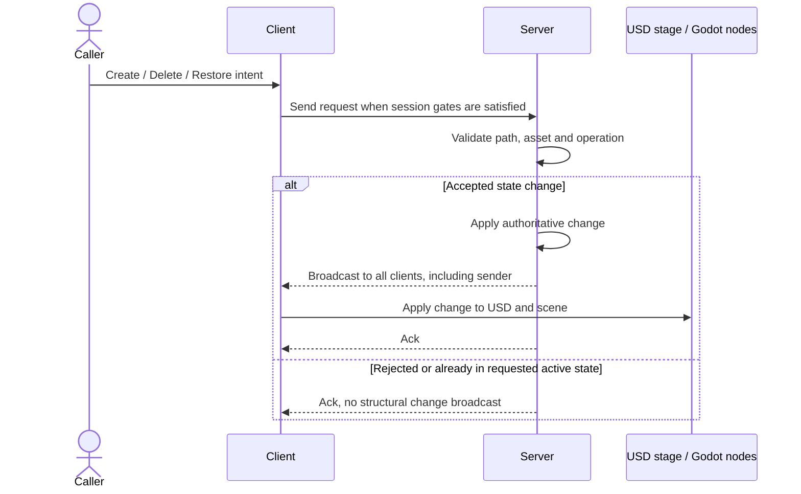

# Structural edits — Create, Delete and Restore

Live-session structural edits use the same native client at runtime and in the
editor. A tool submits intent through `IdtxClient`; core validates and authors it,
then broadcasts the resulting change to every participant, including its sender.
The client does not optimistically create, remove or reactivate a Godot node.

See [usage.md](usage.md) for session setup, [net-core.md](net-core.md) for the
protocol and [stage-authoring.md](stage-authoring.md) for USD/Godot application.

## Request APIs and server authority

| Method | Intent | Wire request |
|---|---|---|
| `request_create_prim(session_id, parent_path, spec)` | Create a child beneath an existing parent | `CreatePrimRequest` |
| `request_delete_prim(session_id, prim_path)` | Set the target inactive | `SetPrimActiveRequest(active=false)` |
| `request_restore_prim(session_id, prim_path)` | Set the target active | `SetPrimActiveRequest(active=true)` |

These methods return void. Requests require a known remote session, completed
snapshot and open socket; otherwise they are dropped, without queuing for
reconnection. Also require a loaded/bound stage and eligible selection, rechecking
the path and owning stage before sending. `is_session_synced(session_id)` reports
only snapshot completion, not all of these conditions.

`ack_received(session_id, ok, error)` reports server results without a request ID,
so it cannot match one of several pending actions or confirm scene conversion has
finished. Observe the stage/activity state for applied changes;
`transform_broadcast_received` covers only transforms. Identical create requests
remain separate requests and can create separate children.

## Creating primitives and assets

`parent_path` is an absolute USD path in the bound stage's namespace. It is not a
Godot `NodePath`, and there is no `/World` requirement. A valid selected parent
might be `/Scene/Group`. Core validates whether the requested child can be placed
there. It assigns the child name; callers must not predict that name.

| Create dictionary field | Meaning |
|---|---|
| `type: String` | One of `Xform`, `Cube`, `Sphere`, `Cone`, `Cylinder`, `Capsule`, `Plane` |
| `reference_path: String` | Selects asset creation when present, taking precedence over `type` |
| `payload: bool` | For assets: `true` creates a payload, `false` or omission creates a reference |
| `transform: Transform3D` | Optional local placement relative to the requested parent |

Here `client` is the existing `IdtxClient`, `session_id` names the ready session,
and `parent_path` is an eligible USD parent in its stage. Each call creates a child.

```gdscript
client.request_create_prim(session_id, parent_path, {"type": "Cube"})

client.request_create_prim(session_id, parent_path, {
    "reference_path": "/kit/asset.usda",
    "payload": false
})

client.request_create_prim(session_id, parent_path, {
    "reference_path": "/kit/asset.usda",
    "payload": true
})
```

The server supplies each shape's schema defaults; this API has no custom dimension
controls, and scaling the placement changes the transform rather than those values.

Omitting `transform` supplies no placement override; pass a `Transform3D` in
parent-local coordinates to request one.
For an asset whose composed root is not transformable, core may create the asset
without the requested placement.

## Request and broadcast flow



The broadcast applies the change; an acknowledgement does not replace it.
See [stage-authoring.md](stage-authoring.md) for USD authoring and conversion.

## Delete and Restore

```gdscript
# selected_path is an eligible prim path in the bound stage.
client.request_delete_prim(session_id, selected_path)

# Later, after deletion has been applied, reactivate that same prim.
client.request_restore_prim(session_id, selected_path)
```

Delete sets `active=false`. The client retains the nodes and USD data but hides
the subtree, suspends processing/collisions/picking, and blocks local transform
authoring and outgoing updates. Attempted movements are corrected automatically;
scripts do not need to enable this protection.

Authoritative external transforms can still update the retained state. Restore
sets `active=true` and uses current live USD and saved runtime settings, without
reloading a file or requesting a snapshot. Restore an inactive ancestor first.

See [stage-authoring.md](stage-authoring.md#inactive-prims-and-retained-runtime-state)
for native activity handling and UI status queries.

## Server validation and rejections

Core validates the parent, asset and operation permissions. A request can be
rejected even when its target is selectable in Godot. Handle server rejections
through `ack_received`; structural changes are applied only through server
broadcasts.

## References, payloads and asset paths

References compose into the containing stage. Payloads add a USD load-control
boundary; this client represents their contents through nested stage nodes.
Referenced assets can themselves contain payloads.

Supply an uploads-root path from the authenticated server file list, such as
`/kit/asset.usda`, in `reference_path`. Set `payload` to `true` for a payload or
`false` for a reference. The client resolves received asset paths against the
stage's root layer; see
[stage-authoring.md](stage-authoring.md#structural-broadcasts-and-asset-paths).

The examples use each asset's defaultPrim. For payload placement, nested edits
and explicit target selection, see
[Behavior, limitations & gaps](usage.md#behavior-limitations--gaps).
