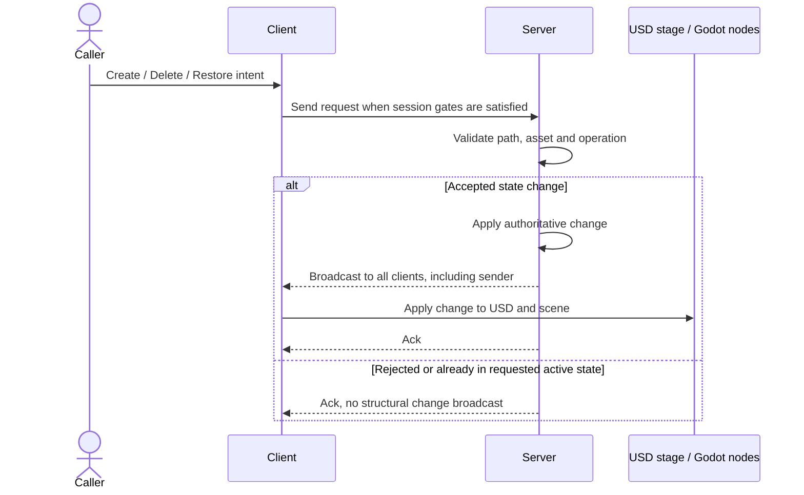

# Structural edits — Create, Delete and Restore

Live-session structural edits use the same native client at runtime and in the
editor. A tool submits intent through `IdtxClient`; core validates and authors it,
then broadcasts the resulting change to every participant, including its sender.
The client does not optimistically create, remove or reactivate a Godot node.

See [usage.md](usage.md) for session setup, [net-core.md](net-core.md) for the
protocol and [stage-authoring.md](stage-authoring.md) for USD/Godot application.

## Request APIs and server authority

| Method | Intent | Wire request |
|---|---|---|
| `request_create_prim(session_id, parent_path, spec)` | Create a child beneath an existing parent | `CreatePrimRequest` |
| `request_delete_prim(session_id, prim_path)` | Set the target inactive | `SetPrimActiveRequest(active=false)` |
| `request_restore_prim(session_id, prim_path)` | Set the target active | `SetPrimActiveRequest(active=true)` |

These methods return an integer request ID: `0` means not submitted; a positive
ID means submitted to the transport. Requests require a known remote session,
completed snapshot and open socket; otherwise they return `0`, without queuing
for reconnection. Also require a loaded/bound stage and eligible selection, rechecking
the path and owning stage before sending. `is_session_synced(session_id)` reports
only snapshot completion, not all of these conditions.

For per-action results, match `ack_received(session_id, request_id, request_kind, ok, error)` to
the returned ID and original action context. IDs belong to a session membership;
if you track pending UI actions, discard them when that context ends or disconnects. Selection
changes alone do not cancel a submitted request. The [binding guide](godot-binding.md#structural-requests)
lists the request-kind constants. Neither submission nor an accepted Ack confirms
scene conversion has finished. Observe the stage/activity state for applied changes;
`transform_broadcast_received` covers only transforms. Identical create requests
remain separate requests and can create separate children.

`prim_created(session_id, prim_path, request_id)` reports each prim created while
the session is live, by this client or another. For this client's create,
`request_id` is the ID `request_create_prim` returned and the signal follows its
`ack_received`; for another client's create it is 0. It is emitted after the
prim's node was converted and added under the stage node, so the node can be
looked up right away; for a payload, the asset's contents may still be loading.
Prims replayed by the join snapshot are not reported: they are part of the state
the stage holds once `snapshot_complete` fires. While the session is not live
(rebuilding after a layer reload or reconnect, or waiting for the requested
snapshot), a prim this membership has not seen before is reported once the
session is live again, so a create made meanwhile, or while disconnected, still
reaches the listener; its own request keeps its `request_id`.

## Creating primitives and assets

`parent_path` is an absolute USD path in the bound stage's namespace. It is not a
Godot `NodePath`, and there is no `/World` requirement. A valid selected parent
might be `/Scene/Group`. Core validates whether the requested child can be placed
there. It assigns the child name; callers must not predict that name.

| Create dictionary field | Meaning |
|---|---|
| `type: String` | One of `Xform`, `Cube`, `Sphere`, `Cone`, `Cylinder`, `Capsule`, `Plane` |
| `reference_path: String` | Selects asset creation when present, taking precedence over `type` |
| `payload: bool` | For assets: `true` creates a payload, `false` or omission creates a reference |
| `transform: Transform3D` | Optional local placement relative to the requested parent |
| `attributes: Array` | Optional typed initial defaults, applied atomically with creation |

Here `client` is the existing `IdtxClient`, `session_id` names the ready session,
and `parent_path` is an eligible USD parent in its stage. Each call creates a child.

```gdscript
var request_id: int = client.request_create_prim(session_id, parent_path, {"type": "Cube"})
if request_id == 0:
    push_warning("Create request was not submitted.")
# Optionally keep positive IDs with the original target to match ack_received.

client.request_create_prim(session_id, parent_path, {
    "reference_path": "/kit/asset.usda",
    "payload": false
})

client.request_create_prim(session_id, parent_path, {
    "reference_path": "/kit/asset.usda",
    "payload": true
})
```

Initial attributes override defaults atomically with creation:

```gdscript
client.request_create_prim(session_id, parent_path, {
    "type": "Cube",
    "attributes": [{
        "name": "size", "type_name": "double",
        "value": {"is_array": false, "doubles": [4.0]}
    }]
})
```

Each entry has a unique `name`, scalar `type_name` and `value` with explicit
`is_array` and a matching component Array: `doubles`, `ints`, `uints`, `bools` or
`strings`. Unsigned components use decimal Strings. Vectors/matrices/quaternions
use flat components; matrices are row-major and quaternions are real, i, j, k.
Values use USD units; send transforms separately (`xformOp:*` and `xformOpOrder`
are excluded). Missing/empty attributes retain defaults. Malformed input returns
`0`; server rejection with `invalid_attribute` creates no partial prim.

Omitting `transform` supplies no placement override; pass a `Transform3D` in
parent-local coordinates to request one.
For an asset whose composed root is not transformable, core may create the asset
without the requested placement.

## Capturing a creation spec

`UsdStageNode3D.get_prim_create_spec(prim_path)` is a read-only, main-thread query
on a loaded stage; no session is required. It returns
`{ok, error, message, spec, warnings}`. On success, pass `spec` to
`request_create_prim(session_id, parent_path, spec)`; inspect warnings for omissions
and `message` on failure.

The spec captures supported defaults and direct overrides on one prim, plus its optional
local USD transform stored as Transform3D relative to the USD parent for reuse by Create.
Reuse it within the same stage/root context; a different parent can change the world pose.
References and payloads retain their asset arc; additional children and overrides on descendants are not copied.

## Request and broadcast flow



The broadcast applies the change; an acknowledgement does not replace it.
See [stage-authoring.md](stage-authoring.md) for USD authoring and conversion.

Create broadcasts apply initial attributes before conversion. Snapshots and
subsequent changes replay defaults through separate attribute broadcasts.

## Delete and Restore

```gdscript
# selected_path is an eligible prim path in the bound stage.
client.request_delete_prim(session_id, selected_path)

# Later, after deletion has been applied, reactivate that same prim.
client.request_restore_prim(session_id, selected_path)
```

Delete sets `active=false`. The client retains the nodes and USD data but hides
the subtree, suspends processing/collisions/picking, and blocks local transform
authoring and outgoing updates. Attempted movements are corrected automatically;
scripts do not need to enable this protection.

Authoritative external transforms can still update the retained state. Restore
sets `active=true` and uses current live USD and saved runtime settings, without
reloading a file or requesting a snapshot. Restore an inactive ancestor first.

See [stage-authoring.md](stage-authoring.md#inactive-prims-and-retained-runtime-state)
for native activity handling and UI status queries.

## Server validation and rejections

Core validates the parent, asset and operation permissions. A request can be
rejected even when its target is selectable in Godot. Handle server rejections
through `ack_received`; use the returned ID when identifying the original
action is needed. Report unowned rejections as session errors; structural changes are
applied only through server broadcasts.

## References, payloads and asset paths

References compose into the containing stage. Payloads add a USD load-control
boundary; this client represents their contents through nested stage nodes.
Referenced assets can themselves contain payloads.

Supply an uploads-root path from the authenticated server file list, such as
`/kit/asset.usda`, in `reference_path`. Set `payload` to `true` for a payload or
`false` for a reference. The client resolves received asset paths against the
stage's root layer; see
[stage-authoring.md](stage-authoring.md#structural-broadcasts-and-asset-paths).

The examples use each asset's defaultPrim. A caller can supply a source prim with
core's explicit-target spelling, such as `/kit/asset.usda</Kit/Chair>`. The client
separates the asset identifier and source target when authoring a reference or
payload arc.

For payload-conversion, placement and nested-edit limitations, see
[Behavior, limitations & gaps](usage.md#behavior-limitations--gaps).
