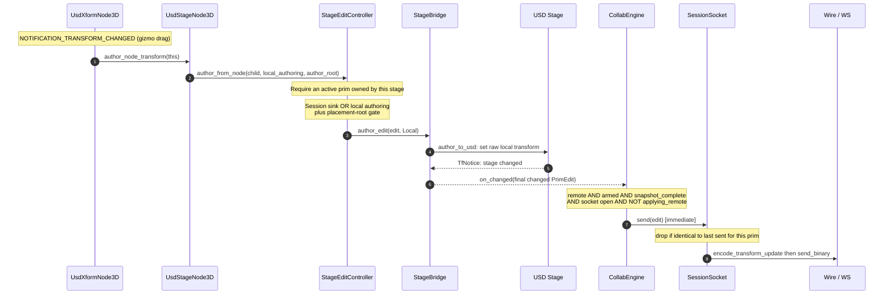
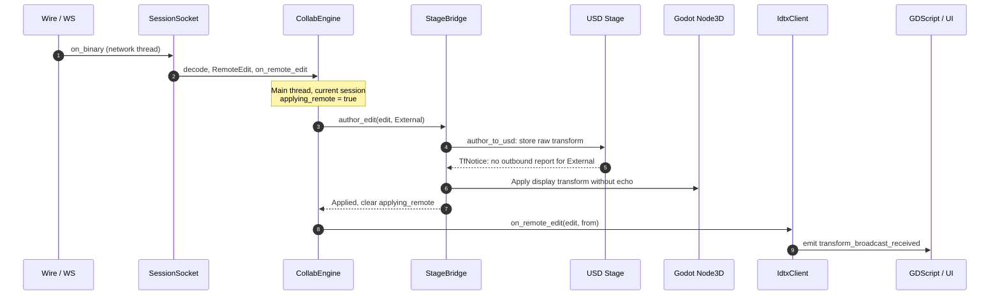

# Transform Sync — Inbound & Outbound Flows

How a transform edit travels between the Godot editor and collaborating peers in
the IDTXFlow real-time client.

---

The layers this builds on — the engine-agnostic core, its ports & adapters, the
threading model, and what a new host engine reuses vs. implements — are described in
[net-core.md](net-core.md) and [godot-binding.md](godot-binding.md). This document
focuses on how a single transform edit travels **outbound** (a local gizmo drag ->
peers) and **inbound** (a peer edit -> my stage + UI). How an edit is *authored*
onto the stage (the node-owned bridge, the local-or-session gate, placement-root
and nested-stage handling) is in [stage-authoring.md](stage-authoring.md).
Create/Delete/Restore use the request flow in [structural-edits.md](structural-edits.md).

---


## Outbound — local gizmo drag to broadcast



**Key points**

- **Author into USD first.** The stage node routes the edit through
  `StageEditController` to `author_edit(edit, EditOrigin::Local)`, which writes the live stage — that
  write *is* the free local save. The USD `TfNotice` is the single "stage changed"
  source, so editor gizmo edits and script edits broadcast through the exact same
  gate. The authoring decision (local vs. session, placement-root/sub-stage rules)
  lives in [stage-authoring.md](stage-authoring.md).
  Inactive prims cannot author outgoing transforms.
- **One path, local or session.** With no session the same author runs but no sink
  is installed, so nothing broadcasts (local-only save). A session installs the
  sink via `attach_stage`, and the identical author now also feeds the broadcast.
- **The broadcast gate** (CollabEngine::on_stage_changed) sends only when
  remote_ AND armed_ AND snapshot_complete_ AND the socket is open AND NOT
  applying_remote_; otherwise the edit is dropped.
  Structural requests do not use this transform arming gate.
- **Arming (two gates).** A remote session arms only when **both** hold: the
  post-attach settle elapsed (`arm_countdown_` = kArmAfterTicks, 3 frames, so USD
  load-time writes settle and do not phantom-broadcast) **and** the join snapshot
  completed (`SnapshotComplete`) — the protocol forbids sending updates before the
  snapshot. A reconnect re-gates on the snapshot only (`snapshot_complete_` is
  cleared and the session disarmed); the settle latch stays set, since a reconnect
  does not reconvert the stage.
- **Immediate send + duplicate suppression.** The bridge reports final changed
  transforms. `SessionSocket::send` additionally drops an edit identical (payload
  only, ignoring the timestamp) to the last one it sent for that prim. Accepted
  changes are sent immediately; a drag can produce multiple distinct updates.
- **Ordering & acks.** Each outbound frame carries the latest applied `server_seq`
  as its base, captured at send time (the server rejects a stale base), and a client
  `request_id` echoed in the matching Ack. Acks are **diagnostic only** — the client
  adopts the ack's `server_seq` (so its own applied edit advances its base) and does
  not resend; the server resolves ordering. An edit authored while disconnected is
  dropped, and the join snapshot is authoritative on reconnect. See
  [net-core.md](net-core.md).

---

## Inbound — peer edit to my stage + UI



**Key points**

- **Thread hop.** Socket callbacks arrive on the transport network thread;
  CollabEngine::open_session_socket's on_remote_edit lambda does
  ports_.dispatcher->post(...) so the apply + observer notification run on the
  Godot main thread. Callbacks from retired sessions are discarded.
- **Echo prevention.** The engine's `applying_remote` gate blocks outbound sends
  while it applies the edit. The bridge applies `External` edits under a guard so
  its USD and node updates do not generate a local change report.
- **Stage stays authoritative.** The edit is authored into USD, then the Godot
  Node3D is set to match. The transform_broadcast_received signal is
  informational for UI only — the stage and node already moved in
  `author_edit(edit, EditOrigin::External)`.
- **Inactive content.** External updates remain accepted while local editing is
  blocked. See [inactive prims](stage-authoring.md#inactive-prims-and-retained-runtime-state).

---

## Matrix and presentation conventions

Wire and USD matrices share **row-vector** cells and bottom-row translation.
`TransformCodec` converts Godot's **column-vector** basis at that boundary;
separate TRS applies scale on the rotated local axes.

Built-in Cone/Cylinder/Capsule visuals have an axis adjustment that is stripped
before authoring and reapplied for display. Plane orientation is carried by its
mesh. Payloads similarly keep up-axis/unit presentation separate from authored
placement and avoid applying placement twice; see
[payload placement](stage-authoring.md#payload-placement-and-its-support-boundary).

## Detailed step-by-step (annotated)

### OUTBOUND — a local gizmo drag → broadcast to peers

```text
User drags gizmo on a UsdXformNode3D (or UsdMeshInstanceNode3D)
        │  Godot fires NOTIFICATION_TRANSFORM_CHANGED
        ▼
[1] source/nodes/UsdXFormNode3D.cpp :: _notification()          (adapter — node)
        │   stage node (nearest UsdStageNode3D) ->author_node_transform(this)
        ▼
[2] source/nodes/UsdStageNode3D.cpp :: author_node_transform()   (adapter)
        │   • StageEditController(*this, get_or_create_bridge())
        │       .author_from_node(child, local_authoring_, author_placement_root_)
        ▼
[3] source/stage_ops/StageEditController.cpp :: author_from_node()   (adapter)
        │   • require an active prim owned by this stage
        │   • require a session sink OR local_authoring; apply placement-root policy
        │   • child->get_transform() → transform_to_prim_edit(path, display_transform)
        │   • bridge_->author_edit(edit, EditOrigin::Local)
        ▼
[4] source/stage_ops/StageBridge.cpp :: author_edit()   (adapter, Godot+pxr)
        │   • convert display transform to raw USD placement
        │   • author_transform → author_to_usd, guarded against nested edits
        ▼
[5] StageBridge :: _on_objects_changed()  (TfNotice listener)
        │   • finish USD/node updates; report only changed final transforms
        │   • on_changed_(raw_edit) ← the sink CollabEngine installed in attach_stage
        ▼
[6] CollabEngine.cpp :: on_stage_changed()      (THE GATE)
        │   send only if  remote_ && armed_ && snapshot_complete_ && socket open && !applying_remote_
        │   socket_->send(edit)                 ← otherwise the edit is dropped
        ▼
[7] shared/.../SessionSocket.cpp :: send()   (agnostic)
        │   drop if identical (payload only) to the last edit sent for this prim
        │   stamp timestamp (IClock::now_millis), take a request_id, then:
        │   ws_->send_binary( wire::encode_transform_update(session_id, edit, base_server_seq, request_id) )
        ▼
[8] shared/.../wire/WireCodec.cpp :: encode_transform_update()   (protobuf, agnostic)
        ▼
[9] IWebSocketTransport::send_binary → IxWebSocketTransport → server → peers
```

### INBOUND — a peer edit → applied to my stage + surfaced to UI

```text
Server pushes a binary frame on the WebSocket
        ▼
[1] IxWebSocketTransport (network thread) → set_on_binary
        ▼
[2] shared/.../SessionSocket.cpp :: handle_binary()          (agnostic)
        │   wire::decode(bytes) → DecodedMessage
        │   Kind::RemoteEdit → on_remote_edit_(edit, from_client_id)
        ▼
[3] shared/.../wire/WireCodec.cpp :: decode()                    (protobuf, agnostic)
        ▼
[4] CollabEngine.cpp :: open_session_socket() lambda  (socket_->on_remote_edit)
        │   ports_.dispatcher->post(...)   ← HOP TO MAIN THREAD (Dispatcher)
        │     on main thread, validate the current callback lifetime:
        │       applying_remote_ = true;
        │       ports_.stage->author_edit(edit, EditOrigin::External);
        │       revalidate lifetime and session after the bridge call
        │       applying_remote_ = false;
        │       observer_->on_remote_edit(edit, from)   ← notify UI
        ▼
[5a] source/stage_ops/StageBridge.cpp :: author_edit(External)   (adapter, Godot+pxr)
        │   • author raw USD placement and update Godot presentation
        │   • guard the application so External produces no local change callback
        ▼
[5b] source/collab/IdtxClient.cpp :: on_remote_edit()   (adapter — CollabObserver)
        │   prim_edit_to_transform(edit) via gxform  → Godot Transform3D
        │   emit_signal("transform_broadcast_received", prim_path, xform, from)
        ▼
[6] GDScript / UI listeners react (purely informational; the stage+node already moved in 5a)
```

---

Structural broadcasts do not emit `transform_broadcast_received`.
